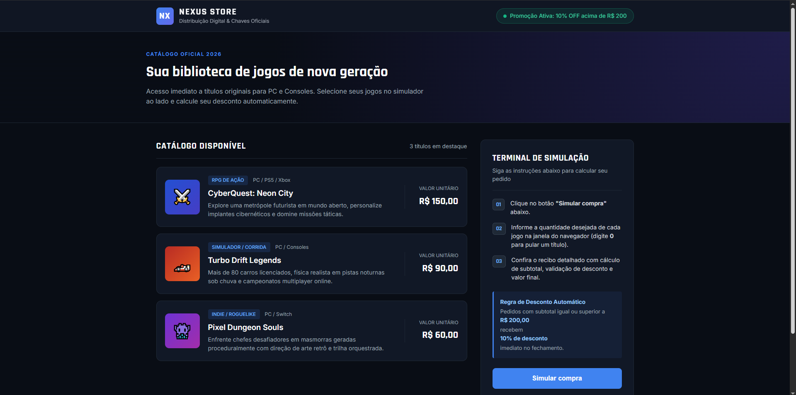
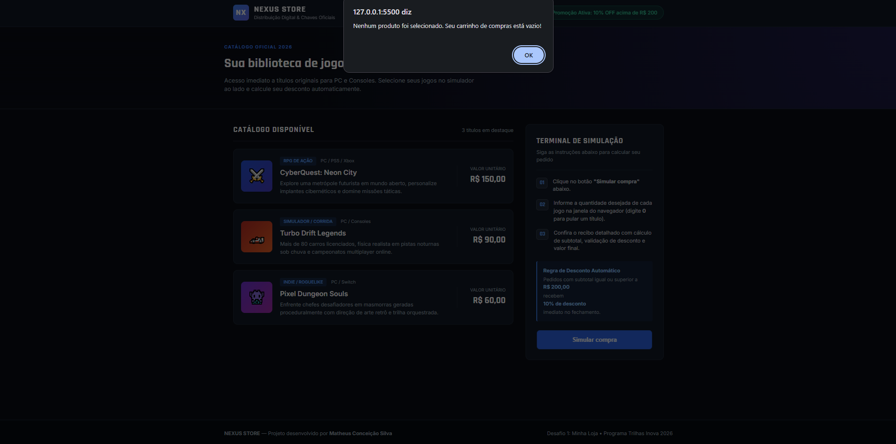
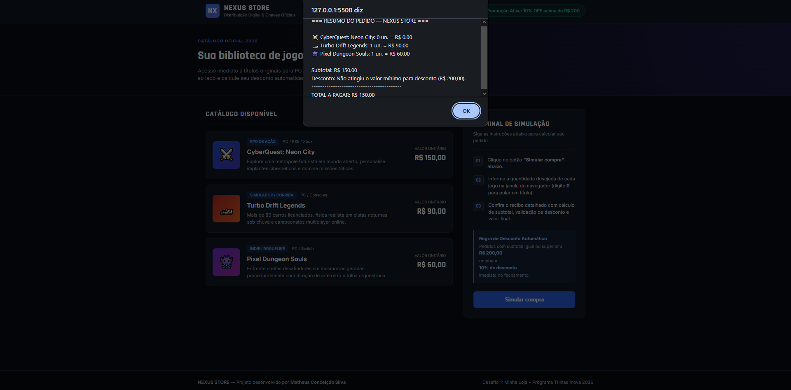
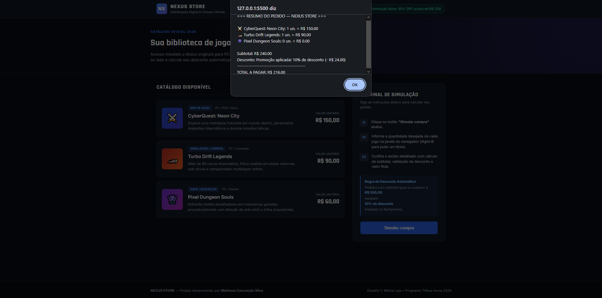

# 🎮 Nexus Store — Simulador de Compras


- **Projeto:** Desafio 1 — Minha Loja: Simulador de Compras
- **Aluno:** Matheus Conceição Silva
- **Trilha:** Desenvolvimento Mobile — *Programa Trilhas Inova 2026*

---

## 📋 Apresentação da Loja, Produtos e Preços

A **Nexus Store** é uma loja digital fictícia voltada para a venda de jogos de PC e Consoles. A interface foi desenhada no formato de uma plataforma moderna de distribuição digital, apresentando o catálogo de jogos à esquerda e um painel de instruções e checkout à direita.

Por meio do simulador em JavaScript, o cliente escolhe a quantidade desejada de cada jogo, visualiza o cálculo automático dos subtotais, recebe **10% de desconto** em compras a partir de **R$ 200,00** e confere o recibo completo ao final.

### Catálogo de Produtos
| Produto | Descrição | Preço |
| :--- | :--- | :--- |
| **CyberQuest: Neon City** | RPG de Ação em mundo aberto futurista (PC / PS5 / Xbox) | R$ 150,00 |
| **Turbo Drift Legends** | Simulador de corrida noturna com modo multiplayer (PC / Consoles) | R$ 90,00 |
| **Pixel Dungeon Souls** | Jogo Indie de aventura em masmorras com visual retrô (PC / Switch) | R$ 60,00 |

---

## 🛠️ Tecnologias e Instruções de Execução

### Tecnologias Utilizadas
- **HTML5:** Estruturação semântica da página dividida entre barra de navegação, banner principal, lista de produtos e painel lateral de simulação.
- **CSS3:** Estilização em tema escuro (*Dark UI*), utilizando variáveis CSS (`:root`), *CSS Grid* para o layout em duas colunas, *Flexbox* para alinhamento interno e responsividade para telas menores.
- **JavaScript:** Lógica do simulador utilizando `prompt()` para entrada de dados, `Number()` para conversão numérica, operadores aritméticos, estruturas condicionais (`if`) e `alert()` para exibir o resultado.

### Estrutura de Arquivos
```text
nexus-store/
├── assets/          # Capturas de tela da página e dos testes
├── index.html       # Estrutura principal da loja
├── style.css        # Folha de estilos e identidade visual
├── script.js        # Lógica de cálculo e regras de negócio
└── README.md        # Documentação do projeto
```

### Como Executar o Projeto
1. Faça o download ou clone este repositório:
   ```bash
   git clone https://github.com/matheuscsx/Desafio-1.git
   ```
2. Certifique-se de que os arquivos `index.html`, `style.css` e `script.js` estão na mesma pasta.
3. Abra o arquivo `index.html` diretamente em qualquer navegador web (ou utilize a extensão **Live Server** no VS Code).
4. Clique no botão **"Simular compra"** no painel direito e digite a quantidade desejada de cada jogo nas caixas de diálogo.

---

## 📸 Capturas de Tela






---

## 🧪 Testes Realizados

Para garantir que o simulador cumprisse todos os requisitos, foram realizados três testes principais cobrindo todas as possibilidades de compra:

| Cenário de Teste | Quantidades Digitadas (`CyberQuest`, `Turbo Drift`, `Pixel Dungeon`) | Subtotal | Desconto (10% acima de R$ 200) | Total a Pagar | Comportamento do Sistema |
| :--- | :---: | :---: | :---: | :---: | :--- |
| **1. Nenhum produto** | `0`, `0`, `0` | R$ 0,00 | Não aplicável | R$ 0,00 | Interrompe a compra e informa que nenhum produto foi selecionado. |
| **2. Compra sem desconto** | `0`, `1`, `1` | R$ 150,00 | R$ 0,00 | **R$ 150,00** | Calcula os valores normalmente e avisa que não atingiu o valor mínimo para desconto. |
| **3. Compra com desconto** | `1`, `1`, `0` | R$ 240,00 | - R$ 24,00 | **R$ 216,00** | Identifica que o valor passou de R$ 200,00, aplica os 10% de desconto e exibe o total final. |

---

## 💡 Dificuldades Encontradas, Aprendizados e Uso de IA

### Dificuldade Encontrada
Minha principal dificuldade foi na parte de **estilização com CSS**. Eu queria criar uma interface que fugisse do básico e tivesse aparência de uma loja de jogos profissional (dividida em colunas, com catálogo horizontal e painel lateral), mas tive dificuldade inicial para posicionar os elementos lado a lado e combinar as cores do tema escuro sem quebrar o layout.

### O que Aprendi
- **No CSS:** Compreendi na prática como funcionam o `display: grid` e o `display: flex` para organizar elementos na tela, além de entender como variáveis CSS (`--cor`), espaçamentos (`padding`, `margin`, `gap`) e bordas alteram diretamente a estrutura visual da página.
- **No JavaScript:** Consolidei a lógica de programação convertendo textos do `prompt()` em números reais com `Number()`, criando travas de validação para compras zeradas com `if` e formatando casas decimais de valores em reais com `.toFixed(2)`.

### Uso de Inteligência Artificial
Utilizei a IA como ferramenta de apoio focada na parte visual do projeto, onde encontrei maior dificuldade:
- **Como ajudou:** A IA gerou a base estrutural do arquivo `style.css` e sugeriu a organização semântica das classes no HTML para criar o visual de plataforma de jogos em duas colunas, além de auxiliar na formatação visual deste `README.md`.
- **O que eu criei e adaptei:** Desenvolvi a lógica de cálculo e validação no `script.js`. Na parte de estilo, analisei o código CSS sugerido pela IA, testei as propriedades para entender exatamente o que cada linha alterava na tela e adaptei cores, tamanhos, textos, preços e espaçamentos para deixar a loja do jeito que eu queria.
- **Como verifiquei os resultados:** Utilizei a extensão **Live Server** no VS Code para inspecionar a página no navegador a cada modificação feita no CSS, vendo em tempo real o impacto de cada propriedade. Para validar o código JavaScript, fiz as contas manualmente antes e depois executei os testes na página (inserindo tudo zero, valores abaixo de R$ 200,00 e valores acima de R$ 200,00), confirmando que todos os resultados exibidos no `alert()` estavam exatos.